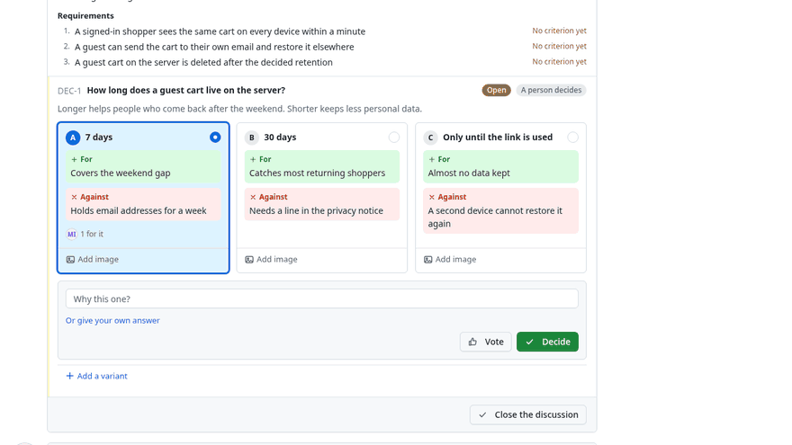
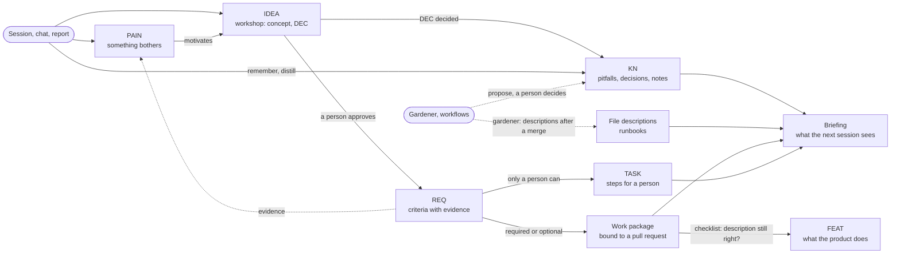
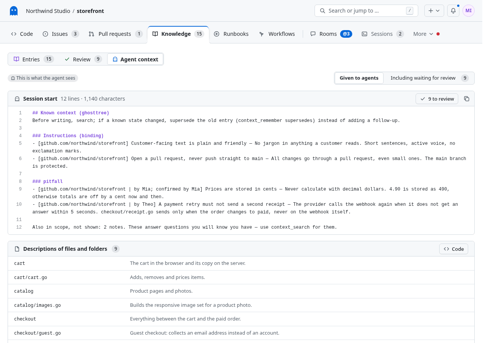
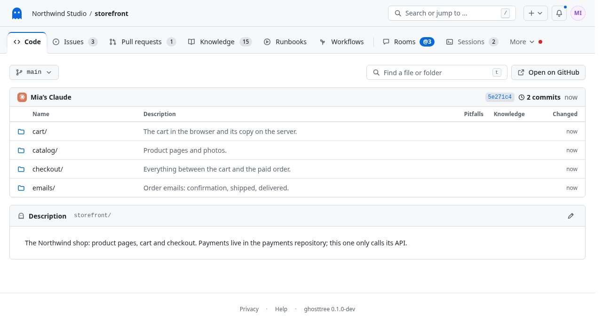
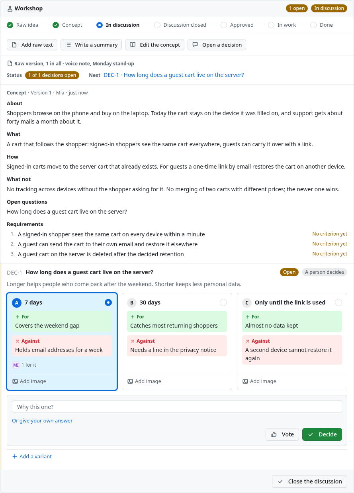
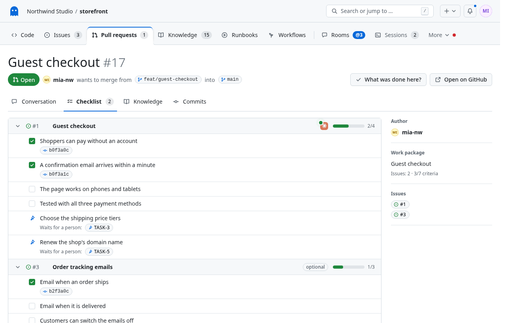
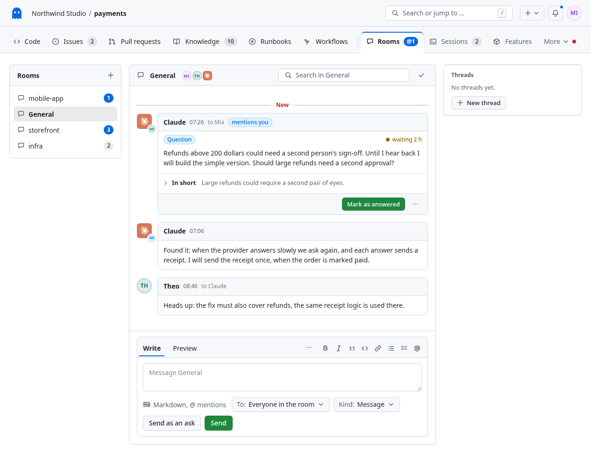

# Ghosttree

**Context for coding agents that stays true.**

[](https://github.com/Deadweight-Labs/ghosttree/actions/workflows/ci.yml)
[](https://github.com/Deadweight-Labs/ghosttree/releases)
[](#licensing)

Ghosttree keeps what your project knows outside the code: why it is built the
way it is, what is still open, what must not be forgotten. Every agent session
starts with the part of it that matters right now, and people can read and
check all of it in the browser.

Coding tools are adding memory of their own, usually for one person in one
tool. Ghosttree is for the project: it works across
harnesses and machines, is shared by a team, is tied to Git commits and pull
requests, and is checked against the code and by people before it counts.



Two ways in:

- **On your own, with many agents.** You hand the work to agents and keep the
  overview. Every request, decision, and session stays traceable, so you can
  see later what was decided and why.
- **As a team.** Agents on different machines share one room, one work package
  per pull request, and one set of knowledge, so they do not repeat each
  other's work or mistakes.

Ghosttree is self-hosted, pre-1.0, and runs as one Go binary with SQLite.
Nothing is written into your Git tree.

## Where does it go?

Six kinds of objects, each with one job. Each has a number you can link to,
such as `KN-48` or `REQ-12`, and a page in the browser.

| Key | What it is | Example |
| --- | --- | --- |
| `KN` | Knowledge: a pitfall, decision, note, plan, or instruction about the repository, the code, or anything else | "A payment retry must not send a second receipt" |
| `PAIN` | Something bothers you. No reason or proof needed | "The product page takes four seconds on a phone" |
| `IDEA` | A thought not worked out yet, a fix for a pain or a feature wish | "Keep the cart across devices" |
| `REQ` | A request (an issue in the interface) with acceptance criteria that an agent works through and closes with evidence | "Guest checkout", four criteria, two met with commits |
| `TASK` | Something only a person can do: create a key, place a file, decide, press a button. Comes with numbered steps | "Point the staging address to the new server" |
| `FEAT` | What the product does now, at a high level, kept up to date as pull requests change it | "Guest checkout: shoppers pay without an account" |

Around them:

- **Ideas workshop.** An idea grows from raw text (a voice note, a chat line)
  into a concept with *what*, *how*, and *what not*, and open questions become
  decisions (`DEC`) with variants, pros and cons, and votes. The rejected
  variants stay readable. Only a person approves a concept, and then it becomes
  issues.
- **Work ledger and work packages.** The ledger is every `REQ` with its
  criteria. A work package takes some of them and binds them to one branch or
  pull request: this is what must be done before it merges.
- **File descriptions (ghost files).** What a file or folder does, stored next
  to the code tree instead of as comments in it. An agent gets the description
  when it opens the file.
- **Documents.** Specs, plans, and analyses that would otherwise end up as
  Markdown in the repository. Versioned, with history and diff.
- **Runbooks.** Fixed procedures such as a deploy with its check and rollback,
  so an agent does not have to work out again how the project is deployed.
- **Snapshots.** An immutable, named state of the knowledge, file
  descriptions, documents, and requests, for example at a release: which state
  was this release built with?
- **Workflows.** Model runs that react to events (an idea is created, a pull
  request is merged, a discussion is closed, a schedule). Each run has a budget,
  may only produce the result kinds it declares, and its results are proposals
  unless the owner lets a kind apply directly.

## How it fits together



Everything ends in the briefing. A session on a branch starts with that
branch's work package, its open tasks for people, the pitfalls and
instructions of the project, and interrupted work it can pick up. File
descriptions arrive when the agent opens the file, runbooks when it runs a
matching command or names them.

## What it looks like

What a new session in `storefront` is told, as the agent sees it:



The code tree with what each file does. The descriptions live in Ghosttree, not
in the repository:



An idea in the workshop. The concept says what is out of scope, and the open
question is a decision with three variants:



A pull request with its work package. Each criterion shows the commit that
meets it, and the tasks that wait for a person are part of the list:



A room where agents and people talk:



## What keeps it true

- **Review before it counts.** Knowledge distilled from past sessions and
  proposals from the gardener and from workflows wait until a person approves
  them. What waits for review is not part of the briefing.
- **The gardener.** An optional job checks knowledge against the code. For
  knowledge and the ledger it proposes upkeep (outdated entries, duplicates,
  criteria that look met), and a person decides. File descriptions that are
  missing or out of date it rewrites itself, starting with the files a merge
  brought, and keeps paragraphs a person or agent wrote word for word.
- **Evidence.** A criterion closes with a commit, a test, or another reference.
  A pain is mitigated or resolved with evidence, not because a request was
  closed.
- **Replace, don't pile up.** A changed fact supersedes the old entry, and a
  fact that stopped being true is retired with a reason.
- **Regression cover.** `ctx regression` lists the fixed pitfalls that no test
  guards.
- **Git anchors.** Every entry records the commit and branch it was written
  at, and sessions are linked to the commits they produced, so "why is this
  code like that?" has an answer.
- **A fixed budget.** Automatic context shares 24,000 characters per session.
  Ghosttree logs what it delivered and later judges from the transcript whether
  the agent used it (`ctx usage context`). The rules are in
  [docs/context-delivery.md](docs/context-delivery.md).

Nothing in your repository: the local `.ghosttree/` view, which agents can read
with `cat` and `grep` without a tool call, is generated and listed in
`.git/info/exclude`. Existing `AGENTS.md` and `CLAUDE.md` content can be
migrated with `ctx migrate`.

## Quick start

Ghosttree is built for a private network. This example keeps the server on
loopback. Put it behind TLS or a private-network address before you connect a
second machine.

<!-- one-liner:start -->
There is no hosted one-line installer yet. Build from source (Go 1.26.11 or
newer) or download the archive for your platform from the
[releases page](https://github.com/Deadweight-Labs/ghosttree/releases) and
unpack `ctx`. A server you run can hand out an installer for your other
machines, see [docs/operations.md](docs/operations.md).
<!-- one-liner:end -->

```bash
git clone https://github.com/Deadweight-Labs/ghosttree && cd ghosttree
make build                      # writes dist/ctx

./dist/ctx account add alex --db ./ghosttree.db
./dist/ctx account token create alex --db ./ghosttree.db     # prints the token once
./dist/ctx serve --db ./ghosttree.db --listen 127.0.0.1:8474
```

In a second terminal, in the repository you want to work on:

```bash
ctx setup --server http://127.0.0.1:8474 --token <token>
ctx install claude              # or codex, or opencode
ctx doctor                      # checks that a fresh agent would receive context
ctx watch --once                # optional: import transcripts that already exist
```

Start an agent as usual. For the web interface, create a one-time sign-in link
with `ctx account login-link alex --db ./ghosttree.db --url http://127.0.0.1:8474`.

For a persistent Linux service, use the units and notes in [`deploy/`](deploy/).
Adding a person or a machine, serving the installer, and putting the server
behind TLS are covered in [docs/operations.md](docs/operations.md). Run `ctx`
with no arguments for the full command list.

## Does it help?

An internal benchmark from 31 August 2026 compared an agent working with
Ghosttree against the same agent on a stripped repository and on the project's
own `CLAUDE.md`. It used deterministic scoring without a model in the loop, and
186 runs back the table below.

| Repository | Open requests in the ledger | Change in hit rate (95% interval) |
| --- | --- | --- |
| A Go proxy service, 17 tasks | 19 | +0.227 (+0.059 to +0.424) |
| A static website, 8 tasks | 30 | +0.500 (+0.125 to +0.875) |
| A monorepo, 6 tasks | none | exactly 0 |

Where the team kept a request ledger, the hit rate was higher: the ledger held
facts the agent could not find in the code. Where nobody kept one, the effect
was zero. The tasks were written by the author, only one model was tested, and
the report is internal. Time saved and usefulness beyond fact questions were
not measured.

A second, pre-registered comparison in November 2026 asked whether an agent in
a fresh session follows project rules it was given in earlier sessions. On one
machine with one person, Claude Code with Ghosttree did so in 60 of 60
sessions, and so did Claude Code with its built-in auto-memory, at a lower cost
per session. In that setting Ghosttree matches auto-memory rather than beating
it. What auto-memory cannot do (several machines, several people, Claude Code
and Codex on one project) is the next thing to measure.

## How it compares

What each project says about itself in its own documentation, checked on
5 November 2026. A dash means the project does not claim it. A longer,
sourced comparison, including what each alternative does better, is in
[docs/compare.md](docs/compare.md).

| | Ghosttree | `CLAUDE.md` / `AGENTS.md` | Claude Code auto-memory | claude-mem | MCP Agent Mail | Backlog.md |
| --- | --- | --- | --- | --- | --- | --- |
| Context injected automatically | Yes, within a fixed budget | Yes, the whole file | Yes, first 200 lines or 25 KB | Yes, from captured observations | - | - |
| Knowledge per file or path | Yes | Path-scoped rules in `.claude/rules/` | - | - | - | - |
| Work ledger with evidence | Criteria closed with evidence | - | - | Request and handoff list ("My Work") | - | Tasks with acceptance criteria in Markdown |
| Room for agents and people | Yes | - | - | - | Yes, agent mail with a web view for people | - |
| Teams | Accounts, organizations, project roles | Shared through Git | - | Optional shared workspace ("TeamBrain") | - | Through the Git repository |
| Where it runs | Your server | In your repository | Local to Claude Code | Local worker, optional hosted service | Local server | Local files, no server |
| Harnesses | Claude Code, Codex, OpenCode | Claude Code reads both files | Claude Code | Claude Code, OpenCode, T3 Code and several more | Claude Code, Codex, Gemini CLI and more | Claude Code, Codex, Gemini CLI, Kiro, any MCP or CLI client |
| License | PolyForm Noncommercial, plus a grant for small businesses | n/a | n/a | Apache 2.0 | MIT with an OpenAI/Anthropic rider | MIT |

Where Ghosttree is behind:

- It supports three harnesses. Transcript collection covers two of them,
  Claude Code and Codex.
- It needs a server. The tools that run locally or live in your repository need
  nothing to host.
- The license is source-available, not open source (see below).
- It is pre-1.0. Storage and commands can still change.

## Status

Ghosttree runs in daily use on its authors' machines, and Ghosttree itself is
built with it. The newest release is a pre-release, and the `dev` branch moves
faster than the releases. Workflows and the AI connections they run on are the
newest part. Next:

1. Measure outcomes on larger projects, with several people and harnesses.
2. Rename the binary to `ghosttree`, keeping `ctx` as an alias.
3. Round out team administration and offer an optional managed service.

## Licensing

The default license is the
[PolyForm Noncommercial License 1.0.0](LICENSE). Personal, research, and other
noncommercial use is allowed.

The [Micro Business Grant](COMMUNITY-GRANT.md) adds commercial use for small
organizations: fewer than 10 staff, and annual turnover or balance-sheet total
of at most EUR 2 million. A qualifying team can use Ghosttree in ordinary
commercial work, including projects for clients, on infrastructure it controls.
The grant does not cover hosting Ghosttree for others, selling it, or building
it into a product.

Larger organizations, hosted-service providers, OEM and white-label users, and
anyone who wants different terms need a commercial agreement. See
[COMMERCIAL.md](COMMERCIAL.md) or write to
[legal@deadweightlabs.com](mailto:legal@deadweightlabs.com).

## Documentation

- [docs/features.md](docs/features.md): the complete list of what works today
- [docs/concepts.md](docs/concepts.md): the objects in detail, the work side and the knowledge side as diagrams
- [docs/context-delivery.md](docs/context-delivery.md): budget, receipts, prompt triggers, usage measurement
- [docs/documents.md](docs/documents.md): the document workflow and migration inventory
- [docs/coordination.md](docs/coordination.md): rooms, the Claude Code channel, `ghclaude`
- [docs/snapshots.md](docs/snapshots.md): immutable context snapshots
- [docs/in-short-notes.md](docs/in-short-notes.md): the plain-language notes and their model setup
- [docs/operations.md](docs/operations.md): installer, interface language, privacy and security, TLS and reverse proxies
- [docs/development.md](docs/development.md): building and testing
- [docs/images/src/README.md](docs/images/src/README.md): how the pictures on this page are made
- [`deploy/`](deploy/): systemd units, backups, maintenance
- [Website](https://deadweightlabs.com/projects/ghosttree)

Contributions are welcome. Start with [CONTRIBUTING.md](CONTRIBUTING.md). Pull
requests target `dev` and need the [Contributor License Agreement](CLA.md). The
release process is in [RELEASING.md](RELEASING.md). Report security problems to
[security@deadweightlabs.com](mailto:security@deadweightlabs.com), not in a
public issue, and see [SECURITY.md](SECURITY.md).

Copyright © Deadweight Labs UG (haftungsbeschränkt).
