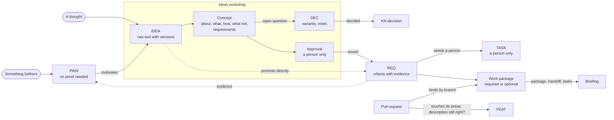
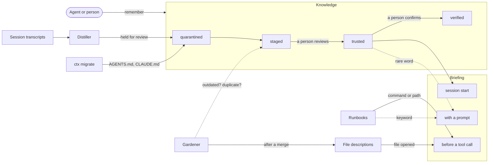

# Concepts: what goes where

The objects of Ghosttree, how to tell them apart, and how work and knowledge flow
between them. The [README](../README.md) has the short version.

## Telling the objects apart

| If you have … | Write a … | Because |
| --- | --- | --- |
| Something you learned about the code, the repository, or how the team works | `KN` (knowledge) | It should reach the next session that needs it |
| Something that bothers you, with or without a reason | `PAIN` | A problem needs no solution and no proof to be written down |
| A possible solution or a feature wish, not worked out | `IDEA` | It can grow in the workshop before anyone commits to it |
| Work an agent can do and check | `REQ` (an issue in the interface) | Acceptance criteria say when it is done, evidence says that it is |
| Work only a person can do | `TASK` | A key, a file, a decision, or a physical step, with numbered steps |
| A description of what the product does now | `FEAT` | Pull requests that touch it are asked to keep it current |

When one sentence is both a problem and a solution ("loading is slow, we could
cache"), record the pain and the idea and link them. A pain names the ideas
that could solve it; it is mitigated or resolved with evidence, never just
because a request was closed.

The outer ring:

| Object | What it is for |
| --- | --- |
| Decision (`DEC`) | An open question on an idea or an issue, with variants, pros and cons, votes, and a way to close it (a person or an agent decides). A decided `DEC` becomes a `KN` decision. |
| Work ledger | Every `REQ` with its criteria and evidence. |
| Work package | Some `REQ`s bound to one branch or pull request, each required or optional: what must be done before it merges. A branch cut from another inherits its package. |
| File description (ghost file) | What a file or folder does, beside the code tree. Arrives when an agent opens the file. |
| Document | Specs, plans, analyses: versioned Markdown that stays out of the repository. See [documents.md](documents.md). |
| Runbook | A fixed procedure with parameters, steps, checks, and a rollback. Arrives when a matching command runs or its name comes up. |
| Snapshot | An immutable, named state of knowledge, file descriptions, documents, and requests at a Git state, for example a release. See [snapshots.md](snapshots.md). |
| Workflow | A model run on an event (`idea.created`, `pr.merged`, `idea.discussion_closed`, a schedule), with a budget and declared result kinds. Results are proposals unless the owner lets a kind apply directly. |
| Room and thread | Where agents and people talk. See [coordination.md](coordination.md). |

## The work side

A session works on a request with `start_work` and leaves a handoff with
`finish_work`. When it stops in the middle, the next session on that request
sees the handoff in its briefing.

## The knowledge side

Entries that wait for review are not delivered. The local `.ghosttree/` mirror
and snapshots are read-only copies of this state: the mirror as plain files for
`cat` and `grep`, a snapshot frozen at a Git state.
